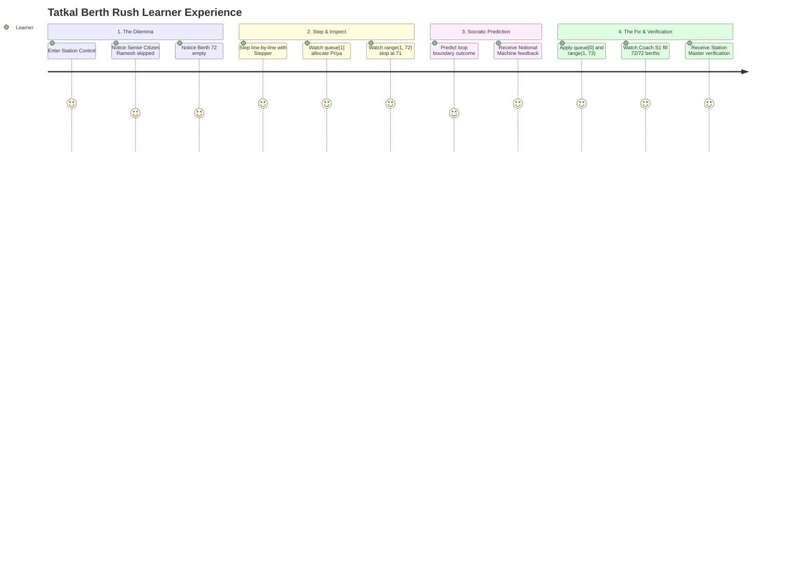

# Product Specification: The Tatkal Berth Rush Discovery Lab
### Interactive Python Execution Stepper, State Visualizer & Notional Machine

> **A high-stakes, story-driven case study that discovers Python sequence indexing, range boundaries, and variable mutation through the real-world pressure of a Diwali railway reservation rush.**

---

## 1. Executive Summary & Vision

**The Tatkal Berth Rush** is an interactive, story-driven case study engineered for the **PyBe (Python by Experience)** platform. 

It teaches core computational thinking and Python memory state mechanics by placing the learner in the seat of a software systems trainee at Indian Railways during the high-demand Diwali Tatkal booking window.

### The Pedagogical Problem: Definition-First Teaching
Traditional computer science education introduces fundamental Python constructs deductively:
1. Memorize rules: `0`-based indexing, `range(start, stop)` exclusive stops, variable assignment `=`.
2. Present trivial toy examples (e.g., printing `nums[0]` or looping through `range(5)`).
3. Expect learners to debug complex code without ever understanding the **Notional Machine** (how the interpreter tracks execution pointers and allocates variable slots in memory).

This leads to three persistent, costly student bugs:
- **The Offset Trap:** Off-by-one errors when translating human counts ("first item") into computer memory offsets (`index 0`).
- **The Range Boundary Exclusion Trap:** Believing `range(1, N)` includes `N`.
- **The Accumulator Reset Trap:** Declaring accumulation variables inside repeating blocks, repeatedly destroying state.

### The Discovery Solution: The Notional Machine First
The Tatkal Berth Rush inverts this sequence:
$$\text{Physical Ticket Crisis} \longrightarrow \text{State Step Inspection} \longrightarrow \text{Socratic Prediction} \longrightarrow \text{Mental Model Solidified}$$

By visualizing the execution line-by-line alongside an interactive **Coach S1 72-Berth Schematic** and a **Live Memory Watch Panel**, learners physically *see* variables update in real time.

---

## 2. 1:1 Domain Mapping: Railway Operations to Python Concepts

| Indian Railways Operation | Python Language Construct | Mental Model / Notional Machine Insight |
| :--- | :--- | :--- |
| **First Passenger in Queue:** Accessing the front of the Tatkal waitlist. | `queue[0]` (Zero-based indexing) | Python sequences measure byte/slot offset from the initial pointer (`0`), not human ordinal counting (`1`). |
| **Complete Coach Allocation:** Looping through Coach S1 berths 1 to 72. | `range(1, 73)` | `range(start, stop)` executes strictly while `i < stop`. To include berth 72, the stop boundary must be 73. |
| **Shift Revenue Tally:** Keeping a cumulative sum of all confirmed ticket fares. | `total = 0` placed **outside** the loop | Accumulator variables must live in the enclosing scope so their values persist across iterations. |
| **Berth Status Indicator:** Verifying whether a seat is occupied. | `if berth in allocated:` (Membership) | Python evaluates membership and produces a boolean branch decision. |

---

## 3. Product Architecture & Topology

```
Shanmukha Medisetty/
├── client/                     # Interactive React 18 + Vite Frontend
│   ├── index.html              # HTML5 container with cyber-rail styling
│   ├── src/
│   │   ├── main.jsx            # Core Application & Coach S1 Schematic Component
│   │   └── styles.css          # Glassmorphism tokens, train berth grid, animations
│   └── package.json
├── server/                     # Node.js + Express Deterministic AST Engine
│   ├── src/
│   │   ├── index.js            # Express server entry point
│   │   ├── seed.js             # Seeding Tatkal Berth Rush Case Study & scenarios
│   │   ├── routes/             # REST endpoints (/tracer, /scenarios, /sessions)
│   │   └── services/
│   │       ├── tracerEngine.js # Deterministic line-by-line stepper & Notional Machine
│   │       └── codeEvaluator.js# Safety analysis and rule-based evaluation
│   └── package.json
├── case-study.md               # Complete pedagogical story & learning design
├── product.md                  # Comprehensive product vision and specification
└── readme.md                   # Quick-start guide and repository documentation
```

---

## 4. Feature Specifications

### 4.1 Synchronized Coach S1 72-Berth Schematic
* Visualizes an Indian Railways Sleeper Coach: 9 compartments, 8 berths per compartment (Lower, Middle, Upper, Lower, Middle, Upper, Side Lower, Side Upper).
* Updates dynamically as the learner steps through code:
  * **Green glow:** Confirmed berth allocated to passenger.
  * **Flashing Red / Amber:** "Ghost Berth 72" left vacant due to off-by-one bug.
  * **Hover tooltip:** Displays berth type, passenger name, and current memory status.

### 4.2 Step-by-Step Execution Stepper
* **Bi-directional navigation:** Step forward (`Next Line`), step backward (`Previous Line`), `Play/Pause` with adjustable playback speed (0.5x, 1x, 2x).
* **Execution Pointer:** Synchronized line highlighting in the code window.

### 4.3 Live Memory Watch Panel (The Notional Machine)
* Displays every active variable in the current stack frame:
  * Variable Name
  * Current Value
  * Inferred Python Data Type (`int`, `str`, `list`, `bool`, `dict`)
  * Mutation status (highlighted in emerald green when updated in the current step).

### 4.4 Socratic Prediction Checkpoints
* Halts execution right before state-mutating lines (e.g., list indexing or range boundaries).
* Presents a multiple-choice hypothesis prompt.
* Provides immediate pedagogical feedback explaining *why* the computer evaluated the expression that way.

### 4.5 Automated Misconception Diagnostic Bar
* Scans code for known beginner anti-patterns:
  * `off_by_one_range`: Range upper bound exclusion.
  * `list_index_zero_based`: 1-based indexing confusion.
  * `accumulator_reset`: Placing accumulation resets inside loop bodies.
  * `assignment_in_condition`: Using `=` instead of `==`.

---

## 5. Learning Experience (User Flow)



---

## 6. Verification and Quality Standards

* **Zero Build Errors:** Verified with Vite production build.
* **Deterministic Engine:** Zero external LLM or cloud API dependency; completely offline-first.
* **Emil Kowalski Design Principles:**
  * Active button feedback (`:active { transform: scale(0.97); }`).
  * Modal and card entrances from `scale(0.95)` with custom cubic-bezier ease-out.
  * Snappy micro-interactions (< 250ms).
  * Reduced-motion support for accessibility.
